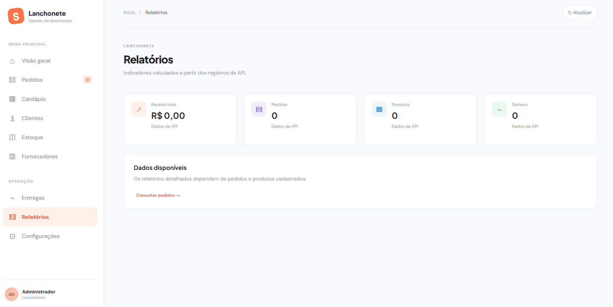
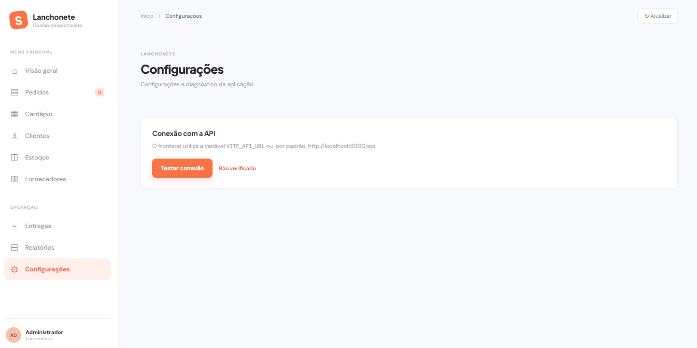

# Lanchonete

> Sistema completo de gestão e atendimento para lanchonete, integrando API REST, interface web reativa e banco de dados relacional.

O **Lanchonete** é uma solução desenvolvida para otimizar o fluxo operacional de uma lanchonete. Ele resolve problemas comuns de desorganização em pedidos, controle manual de estoque e inconsistências financeiras, oferecendo controle integral de cadastros (produtos, categorias, adicionais, ingredientes, clientes, funcionários e fornecedores), fluxo de pedidos presenciais e delivery com validação de pagamentos e histórico de status.

---

## 🌐 Idiomas / Localization

- [Português (Brasil)](README.md)
- [English](docs/README_en.md)

---

## 🏷️ Badges

[](https://github.com/guimattosc/TCC-Senai/releases)
[](LICENSE)
[](https://fastapi.tiangolo.com)
[](https://react.dev/)
[](https://www.postgresql.org/)
[](https://www.docker.com/)

---

## 📑 Navegação

- [Início Rápido](#-início-rápido-quick-start)
- [Como Funciona](#-como-funciona-how-it-works)
- [Funcionalidades](#-funcionalidades-features)
- [Telas do Sistema](#-telas-do-sistema-screenshots)
- [Perguntas Frequentes](#-perguntas-frequentes-faq)
- [Documentação](#-documentação-documentation)

---

## 🚀 Início Rápido (Quick Start)

### Pré-requisitos

- **Docker** e **Docker Compose** instalados (recomendado para execução simplificada).
- *Ou para execução manual sem Docker:*
  - **Python >= 3.11**
  - **Node.js >= 20.x** e **npm**
  - Instância do **PostgreSQL 16** ativa

### Instalação e Execução

Clone o repositório e execute a stack completa via Docker Compose na raiz do projeto:

```bash
docker compose -f Compose.yaml up --build
```

Após a inicialização dos contêineres:
- **Frontend (Web):** [http://localhost:3000](http://localhost:3000)
- **API Backend:** [http://localhost:8000](http://localhost:8000)
- **Documentação Swagger/OpenAPI:** [http://localhost:8000/docs](http://localhost:8000/docs)
- **Health Check:** [http://localhost:8000/health](http://localhost:8000/health)

### Exemplo de Uso (CLI / Terminal)

> **Cenário:** Como verificar a integridade da API e inspecionar a lista de produtos via terminal?

```bash
# Verificar a saúde da API
curl -s http://localhost:8000/health

# Consultar a lista de produtos cadastrados (retorno em JSON)
curl -s http://localhost:8000/produtos | jq .
```

---

## ⚙️ Como Funciona (How it works)

A aplicação é orquestrada em 3 camadas de contêineres:
1. **Banco de Dados (PostgreSQL 16):** Inicializa com volume persistente (`postgres_data`) e passa pelo healthcheck com `pg_isready`.
2. **Backend (FastAPI + SQLAlchemy + Alembic):** Aguarda o banco estar saudável, executa automaticamente as migrações de esquema do Alembic e expõe os endpoints REST na porta `8000`.
3. **Frontend (React + Vite + TypeScript):** Construído com build multi-stage e servido por Nginx na porta `3000`, consumindo diretamente os endpoints da API.

---

## 🧩 Funcionalidades (Features)

| Componente / Alvo | O que a aplicação entrega / produz | Requisitos / Dependências |
| :--- | :--- | :--- |
| **Gestão de Pedidos** | Fluxo de abertura de pedidos, inclusão de itens com adicionais, validação de taxa de entrega para delivery e conferência de somatório de pagamentos | Backend FastAPI + SQLAlchemy + PostgreSQL |
| **Catálogo & Estoque** | Cadastro e gerenciamento completo de categorias, produtos, ingredientes e adicionais | Backend FastAPI + PostgreSQL |
| **Pessoas & Parceiros** | Gestão de clientes com endereço para entrega, funcionários por cargo e fornecedores | Backend FastAPI + PostgreSQL |
| **Interface de Atendimento (Frontend)** | Painel web interativo para garçons, caixas e administradores realizarem pedidos e consultas em tempo real | Node.js / Nginx + React 19 + TypeScript |
| **Migrações e Modelagem** | Versionamento automático do banco de dados relacional e histórico de alterações estruturais | Alembic + SQLAlchemy |

---

## 📸 Telas do Sistema (Screenshots)

### 📊 Visão Geral & Relatórios
| Visão Geral (Dashboard) | Relatórios |
| :---: | :---: |
|  |  |

### 🛒 Pedidos & Atendimento
| Novo Pedido | Configurações do Sistema |
| :---: | :---: |
|  |  |

### 📦 Catálogo & Estoque
| Cadastro de Produto | Cadastro de Ingrediente |
| :---: | :---: |
|  |  |

### 👥 Clientes & Parceiros
| Cadastro de Cliente | Cadastro de Fornecedor |
| :---: | :---: |
|  |  |

---

## 💡 Casos de Uso (Showcases)

### Caso de Uso 1: Fluxo de Pedido Delivery com Múltiplos Pagamentos
Gerenciamento de um pedido delivery contendo lanches com adicionais extras, validação de endereço do cliente e rateio do valor entre dois métodos de pagamento (ex.: Cartão e Dinheiro), assegurando que o status só avance após validação do valor total.
- 🔗 [Ver documentação de endpoints](/docs/modelagem.pdf)

### Caso de Uso 2: Migração e Versionamento Automatizado
Atualização contínua do banco de dados em homologação/produção sem perda de dados:
```bash
cd Backend
alembic upgrade head
```

---

## ❓ Perguntas Frequentes (FAQ)

### Quais plataformas e ambientes são suportados?
A aplicação suporta qualquer sistema operacional compatível com Docker (Windows com WSL2, Linux e macOS). Em ambiente local de desenvolvimento, suporta Python 3.11+ e Node.js 20+.

### Como rodar migrações do banco manualmente?
No diretório `Backend`, ative o ambiente virtual e execute:
```bash
alembic revision --autogenerate -m "nome_da_migracao"
alembic upgrade head
```

### Como reportar bugs ou contribuir com o projeto?
Abra uma *Issue* detalhando o erro com prints e logs do terminal, ou envie um *Pull Request* seguindo o padrão de commits e garantindo que o build do Compose continue íntegro.

---

## 📚 Documentação (Documentation)

- [Diagrama de Entidade-Relacionamento (DER)](docs/DER.mwb)
- [Documentação de Modelagem do Banco de Dados](docs/modelagem.pdf)
- [Situação de Aprendizagem / Especificações SENAI](docs/SA_BANCO_DADOS_COM_DESENVOLVIMENTO.pdf)
- [Documentação Interativa da API (Swagger)](http://localhost:8000/docs)
