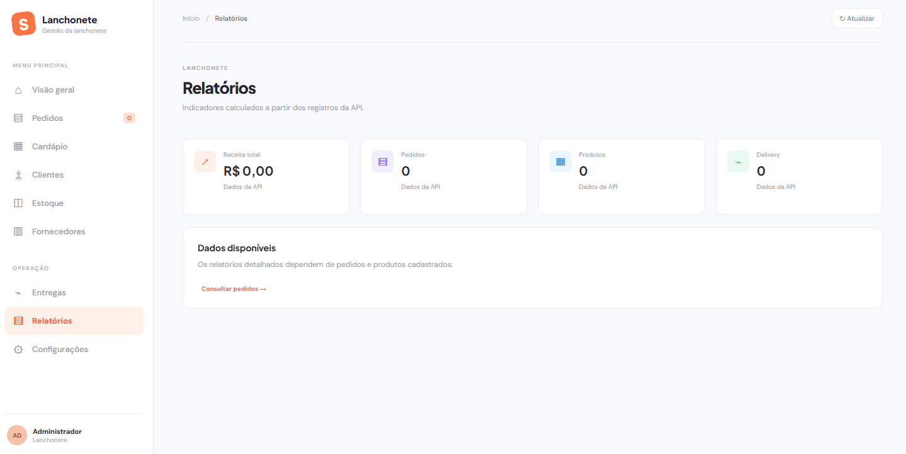
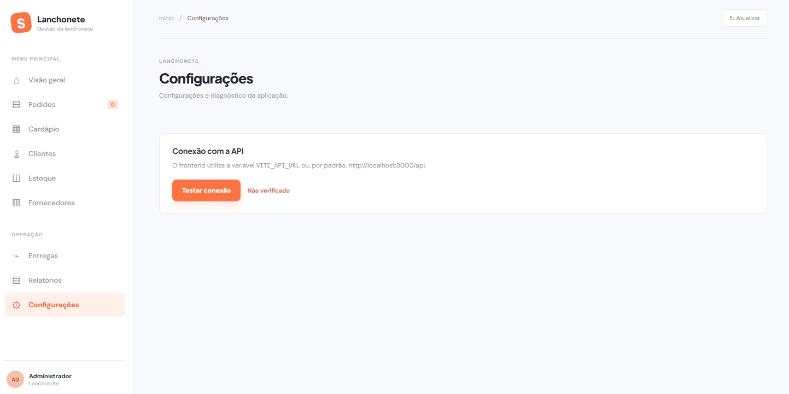

# Lanchonete

> Complete management and ordering system for snack bars, integrating a REST API, reactive web interface, and relational database.

**Lanchonete** is a solution designed to streamline the operational flow of snack bars and diners. It solves common operational bottlenecks such as order disorganization, manual inventory tracking, and payment inconsistencies by providing full management of records (products, categories, extras, ingredients, customers, employees, and suppliers), dine-in and delivery order workflows with payment balance validation, and status tracking history.

---

## 🌐 Localization

- [Português (Brasil)](../README.md)
- [English](README_en.md)

---

## 🏷️ Badges

[](https://github.com/guimattosc/TCC-Senai/releases)
[](../LICENSE)
[](https://fastapi.tiangolo.com)
[](https://react.dev/)
[](https://www.postgresql.org/)
[](https://www.docker.com/)

---

## 📑 Navigation

- [Quick Start](#-quick-start)
- [How it Works](#-how-it-works)
- [Features](#-features)
- [System Screenshots](#-system-screenshots)
- [FAQ](#-faq)
- [Documentation](#-documentation)

---

## 🚀 Quick Start

### Prerequisites

- **Docker** and **Docker Compose** installed (recommended for one-command execution).
- *Or for manual execution without Docker:*
  - **Python >= 3.11**
  - **Node.js >= 20.x** and **npm**
  - Active **PostgreSQL 16** database instance

### Installation & Startup

Clone the repository and spin up the complete stack using Docker Compose from the root directory:

```bash
docker compose -f Compose.yaml up --build
```

Once all containers are up and healthy:
- **Frontend (Web):** [http://localhost:3000](http://localhost:3000)
- **Backend API:** [http://localhost:8000](http://localhost:8000)
- **Interactive OpenAPI/Swagger:** [http://localhost:8000/docs](http://localhost:8000/docs)
- **Health Check:** [http://localhost:8000/health](http://localhost:8000/health)

### CLI / Terminal Usage Example

> **Scenario:** Check API health and inspect the product list via terminal.

```bash
# Verify API health
curl -s http://localhost:8000/health

# Query registered products (JSON format)
curl -s http://localhost:8000/produtos | jq .
```

---

## ⚙️ How it Works

The application runs orchestrated across 3 containerized services:
1. **Database (PostgreSQL 16):** Starts with persistent storage (`postgres_data`) and is monitored via `pg_isready`.
2. **Backend (FastAPI + SQLAlchemy + Alembic):** Waits for the database to become healthy, automatically runs Alembic database migrations, and exposes REST endpoints on port `8000`.
3. **Frontend (React + Vite + TypeScript):** Built using a multi-stage Docker build and served through Nginx on port `3000`, communicating directly with the backend API.

---

## 🧩 Features

| Component / Target | Output / Deliverable | Requirements / Dependencies |
| :--- | :--- | :--- |
| **Order Management** | Order creation, item customization with extras, delivery fee calculations, and payment sum validation | FastAPI + SQLAlchemy + PostgreSQL |
| **Catalog & Inventory** | Comprehensive CRUD for categories, products, ingredients, and add-ons | FastAPI + PostgreSQL |
| **People & Partners** | Customer management with delivery addresses, employees grouped by role, and supplier records | FastAPI + PostgreSQL |
| **Point of Sale / Web UI** | Responsive and reactive web interface for staff, cashiers, and administrators | React 19 + TypeScript + Vite + Nginx |
| **Database Migrations** | Automated database schema versioning and change tracking | Alembic + SQLAlchemy |

---

## 📸 System Screenshots

### 📊 Overview & Reports
| Overview (Dashboard) | Reports |
| :---: | :---: |
|  |  |

### 🛒 Ordering & POS
| New Order | System Settings |
| :---: | :---: |
|  |  |

### 📦 Catalog & Stock
| Product Registration | Ingredient Registration |
| :---: | :---: |
|  |  |

### 👥 Customers & Partners
| Customer Registration | Supplier Registration |
| :---: | :---: |
|  |  |

---

## 💡 Showcases

### Showcase 1: Delivery Order with Split Payments
Handling a delivery order with customized burgers, address verification, and splitting the total cost across multiple payment methods (e.g., Credit Card and Cash), ensuring status cannot transition to preparation until the total is fully covered.
- 🔗 [Review Data Model](/docs/modelagem.pdf)

### Showcase 2: Automated Schema Migrations
Safe, continuous migrations in development and production environments:
```bash
cd Backend
alembic upgrade head
```

---

## ❓ FAQ

### Which platforms and environments are supported?
Any operating system compatible with Docker (Linux, Windows with WSL2, macOS). For local manual setups, Python 3.11+ and Node.js 20+ are required.

### How do I run database migrations manually?
Navigate to the `Backend` directory, activate your virtual environment, and run:
```bash
alembic revision --autogenerate -m "migration_name"
alembic upgrade head
```

### How can I report bugs or contribute?
Open an issue describing the error alongside logs and screenshots, or submit a Pull Request ensuring Docker Compose builds without errors.

---

## 📚 Documentation

- [Entity-Relationship Diagram (DER)](DER.mwb)
- [Database Modeling Documentation](modelagem.pdf)
- [Learning Scenario & Requirements (SENAI)](SA_BANCO_DADOS_COM_DESENVOLVIMENTO.pdf)
- [Interactive API Docs (Swagger)](http://localhost:8000/docs)
